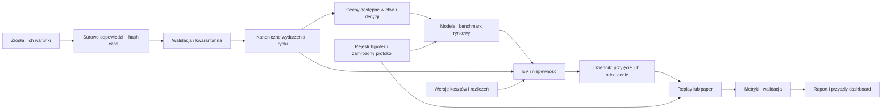

# Architektura Sports Edge AI

Decyzja architektoniczna TASK 001: modułowy monolit Python 3.12+, lokalnie na Windows.
Obliczenia deterministyczne oddzielone od I/O, walidacja źródeł przed modelowaniem.
Poniższy przepływ jest projektem docelowym; status implementacji podano w tabeli.



## Moduły i granice

| Komponent | Odpowiedzialność / kontrakt | TASK 001 |
|---|---|---|
| Sports Discovery | Ocena danych, liczby wydarzeń, kosztu, płynności, opóźnień; bez ROI holdoutu | Metoda i ranking w dokumentacji |
| Ingestion | Adapter źródła → surowe bajty + manifest, paginacja, retry, limit budżetu | `DataAdapter` Protocol |
| Data Quality | Typy, UTC, mapowania ID, kwarantanna, brak imputacji kursów | Podstawowe kontrole w `quality.py`, `temporal.py` |
| Feature Engineering | Wspólne rolling/as-of, adaptery sportów, wersje transformacji | Model `FeatureSnapshot`, projekt |
| Prediction | Wspólny kontrakt `Predictor`; rozkład stanów i niepewność | Kontrakt i walidacja |
| Edge Detection | Rozkład wypłat, koszty, aktualność oferty, przyczyny odmowy | Arytmetyka i walidatory; orkiestracja później |
| Backtesting | Deterministyczny replay, nested walk-forward, opóźnienia, holdout | Projekt poniżej, bez silnika wykonawczego |
| Paper Trading | Zapis przed startem, później wynik/CLV, append-only | Modele i `AppendOnlyStore`; bez automatycznej pętli |
| Dashboard | Sport/liga/rynek/model/bookmaker, ROI, CLV, kapitał, kalibracja, CI | Specyfikacja, bez UI |

## Struktura obecna i rozwój

```text
config/markets.toml                 # definicje szablonów rynków
config/tax/pl_sts_research.toml      # wersja kosztów o jawnej ważności
docs/                              # badania, architektura i protokoły
src/sports_edge/
  domain.py                        # 16 modeli + Entity
  temporal.py                      # pięć zegarów i dostępność
  probability.py                   # rozkłady i benchmark rynku
  settlement.py                    # przepływy pieniężne
  markets.py                       # reguły rynku i rejestr adapterów
  edge.py                          # EV
  quality.py                       # kontrole zestawu
  config.py                        # TOML
  contracts.py                     # przyszłe adaptery i magazyn
  cli.py                           # syntetyczne demo
tests/                             # testy offline
.github/workflows/ci.yml            # Windows/Linux, Python 3.12/3.13
```

Przyszłe pakiety: `adapters/sources`, `adapters/sports`, `features`, `models`,
`experiments`, `backtesting`, `paper`, `storage`, `reporting`. Powstaną wraz z działającą
funkcją, nie jako dziesiątki pustych katalogów. Konfiguracja/artefakty przekazywane
ścieżkami, bez zależności od litery dysku. Serwer później może uruchamiać ten sam kod.

## Warstwa danych

Surowe odpowiedzi: `data/raw/{source}/{retrieval_date}/{sha256}` + osobny manifest
z URL bez sekretów, parametrami, czasem, warunkami retencji, wersją adaptera i statusem HTTP.
Bronze pozostaje niezmienny; poprawki generują nowe obiekty. Silver: Parquet z wersją
schematu i mapowaniem zewnętrznych ID. DuckDB służy do analizy, nie jako dziennik transakcji.
SQLite na początku przechowuje hipotezy, decyzje, wersje i rozliczenia; PostgreSQL
dopiero gdy potrzebny będzie dostęp wielu procesów. Nie budujemy mikroserwisów.

Relacje: Sport → Competition → Season → Event; Event ma **N** Participant przez przyszłą
tabelę udziałów z rolą/pozycją. Event → Market → Selection → OddsSnapshot.
Bookmaker i DataSource są osobnymi bytami (aggregator nie jest operatorem).
FeatureSnapshot + ModelVersion → Prediction → PaperBet → Settlement.
Experiment wiąże wersje, podziały, konfigurację, wyniki i niezależność walidacji.
Przyszły magazyn egzekwuje FK i unikalność; obecny `basic_issues` sprawdza ich podzbiór.

`Market` przechowuje wersję definicji, okres, linię Decimal, subject_id (np. zawodnik),
dogrywkę i wersję reguły. Adapter operatora wiąże ofertę z odpowiednią instancją rynku.
Nigdy nie porównujemy kursów różnych linii, okresów, regulaminów lub graczy.

## Czas i niezmienność

Każdy rekord pochodzący ze źródła ma envelope `Timestamps`: event_time, valid_at,
published_at, observed_at, ingested_at. Pierwsze cztery mogą być nieznane; czas pobrania
jest mierzony lokalnie. Registry referencyjny ma wersję źródła w magazynie; nie udajemy,
że encja Sport sama ma rynkowy czas publikacji. Daty bez godziny pozostają datami
w raw. Nie zamieniamy ich w fikcyjne 00:00 UTC.

`frozen=True` chroni podstawowe rekordy w pamięci. Trwały magazyn w TASK 002 ma odrzucać
UPDATE/DELETE decyzji, używać unikalnych ID, hashy i korekt przez `supersedes_id`.
Hash lokalny wykrywa zmiany, ale nie dowodzi niezależnie czasu publikacji; potrzebny jest
zewnętrzny znacznik lub kontrola dostępu do zamrożonych artefaktów.

## Projekt replay i paper

Kolejka deterministyczna: `(available_at, source_priority, record_id)`. Wirtualny zegar
przesuwa się wyłącznie naprzód. W każdym foldzie dopasowanie preprocessing, modeli,
kalibracji i progów następuje na dozwolonym prefiksie. Strategia emituje decyzję wraz
z reason code: `accepted`, `missing_timestamp`, `stale_odds`, `unknown_rules`,
`negative_net_ev`, `uncertain_edge`, `correlated_exposure`, `insufficient_evidence`.
Odnotowujemy też wszystkie odmowy, błędy i brak oferty.

Po opóźnieniu wykonania oferta musi nadal być dostępna. Nie wstawiamy automatycznie
korzystniejszego kursu. Zakłady z jednego wydarzenia to klaster; portfel ma limity
na event/dzień/uczestnika. Nie ma interfejsu wysyłającego zakłady do operatora.
Paper używa identycznego przepływu z zegarem rzeczywistym i niezmiennym dziennikiem.

## Modele i LLM

Benchmarki: częstości z treningu, Elo/Glicko, rynek bez marży z chwili decyzji.
Poisson i Dixon–Coles wymagają adaptera futbolu; logistic, LightGBM, CatBoost, modele
bayesowskie/hierarchiczne i ensemble implementują ten sam `Predictor`. Dobór dopiero
po zdefiniowaniu danych i hipotezy. Nie wdrożono żadnego z nich w TASK 001.

LLM otrzymuje zamrożony pakiet informacji z datami i źródłami, zwraca strukturę
`market_id`, `state_id → probability`, brakujące dane i metodę niepewności.
Zapis: provider, dokładny model i wersja, prompt, hash oraz chronione wejście, źródła,
czas wysłania/odpowiedzi, parametry, koszty, odmowa/timeout i surowa odpowiedź.
`Prediction` przechowuje odwołania; tekst wejścia/raw trafia do magazynu artefaktów.
Nie normalizujemy automatycznie błędnej odpowiedzi. Samoocena pewności LLM nie jest CI.

Oficjalna dokumentacja na dzień audytu wymienia **`gpt-6-astra` w Responses API**.
Nie sprawdzono uprawnień ani rozliczeń konta użytkownika i nie wykonano wywołania API.
Abonament ChatGPT sam w sobie nie jest testem dostępności tego modelu dla projektu.
Adapter pozostaje wymienny: OpenAI, inni dostawcy, model lokalny.
[OpenAI: Using GPT-6](https://developers.openai.com/api/docs/guides/latest-model).

Historyczna ocena LLM może zawierać wiedzę o wynikach mimo deklarowanego cutoff.
Główny test LLM będzie prospektywny; kontrola: ten sam pakiet informacji z/bez LLM,
ten sam rynek, niezmieniony budżet, ensemble uczony wyłącznie na wcześniejszych danych.

## Dashboard w przyszłości

Widoki: jakość/pokrycie danych; rejestr eksperymentów; walk-forward; paper; porównania
sportów, lig, modeli, operatorów i rynków. W każdym widoku n wydarzeń i n selekcji,
brutto/netto, CLV i jego pokrycie, drawdown, krzywa kapitału, kalibracja i CI.
Filtry eksploracyjne są oznaczone jako eksploracja, nie tworzą nowego dowodu potwierdzającego.

## TASK 002 — moduły zaimplementowane

| Komponent z tabeli wyżej | Implementacja | Uwagi |
|---|---|---|
| Ingestion | `pdf/` (layout, sts, generic, engine), `offers/sources.py` | STS zweryfikowany na autentycznych PDF; Superbet/inne — parser ogólny niezweryfikowany |
| Data Quality | `offers/model.py` (kody problemów, ocena jakości), kwarantanna `review_items` | Brak zgadywania kursów; niejednoznaczne wiersze → weryfikacja ręczna |
| Magazyn | `storage.py` (SQLite v2, append-only), `repository.py` | Każdy import to nowy snapshot; historia kursów zachowana |
| Dopasowanie | `matching.py` | Sport + czas + klucze nazw; podobieństwo nazw daje tylko kandydata |
| Prediction | `models/registry.py`, `models/elo.py`, `models/calibration.py`, `sportsdata.py` | Status „validated” tylko przez politykę (n, ECE, benchmark rynku, as-of) |
| Edge Detection | `analysis/edge_engine.py`, `analysis/comparison.py` | Ocena kursu oddzielona od EV; benchmark rynku nie jest prognozą |
| Kupon dnia | `analysis/coupon.py`, `config/coupon_policy.toml` | SOLO z bramkami; AKO tylko z jawnym modelem łącznym |
| Paper Trading | `paper.py` | Tryby rozdzielone; rozliczenia przez `settlement.settle` |
| Dashboard | `app/` (Streamlit, 127.0.0.1) | 8 widoków, tryb DEMO w osobnej bazie |
| Operacje | `backup.py`, `export.py`, `services.py`, `cli.py`, `start.bat`, `start.ps1` | Kopie `backups/RRRR-MM-DD_GG-MM-SS/`, eksport JSON/CSV |
